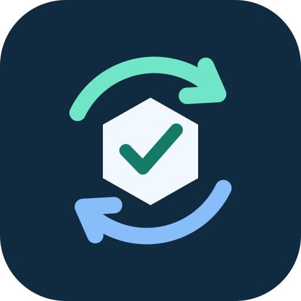

<p align="center"></p>

# Agent Ops Skills

[繁體中文](README.zh-TW.md) · [Agent compatibility](docs/AGENT_COMPATIBILITY.md) · [Installation](docs/INSTALLATION.md) · [CI](https://github.com/lzhs1995/agent-ops-skills-public/actions/workflows/test.yml)

Two portable skills for verified Baidu Netdisk transfers and bounded local disk maintenance. Python 3.11+; the core has no third-party Python dependencies.

| Skill | What it does |
| --- | --- |
| [baidu-netdisk-transfer](skills/baidu-netdisk-transfer/SKILL.md) | Plan transfers, resume original attempts, and verify independent downloads against full hashes. |
| [local-disk-maintenance](skills/local-disk-maintenance/SKILL.md) | Inspect capacity, prepare bounded plans, and verify authorized cleanup or APFS compression. |

## Try the command interfaces

From the repository root, these commands show help without installing skills or starting an operation:

```sh
python3 -B skills/baidu-netdisk-transfer/scripts/netdisk.py --help
python3 -B skills/local-disk-maintenance/scripts/disk.py --help
python3 -B tools/install.py
```

The installer defaults to a preview. Read [what installation changes](docs/INSTALLATION.md) before using `--apply`. Existing credentials, profiles, runtime releases and operation receipts stay on the local machine. Installing skills does not authorize an upload or cleanup.

## Use with an agent

Point the agent to the selected `SKILL.md`, then ask it to use the bundled script. The local installer manages the two skills in existing Codex, Claude Code and Gemini directories, plus a shared `.agents/skills` entry. Other agents can read the same Markdown and execute the same CLI; automatic discovery is not claimed for clients without a tested adapter.

[Agent compatibility](docs/AGENT_COMPATIBILITY.md) distinguishes portable CLI access, installer coverage and live client validation. No network service or MCP server is required by this package.

## Verify a checkout

```sh
python3 -B -m unittest discover -s tests -v
python3 -B tools/secret_check.py --history
```

Use `tools/secret_check.py --root .` for an exported folder without Git history. Tests use isolated fixtures. Real transfers require a separately authorized account, exact source and destination, and independent download verification; a successful fixture test is not a live account test.

## Release status

**Published source snapshot:** [lzhs1995/agent-ops-skills-public](https://github.com/lzhs1995/agent-ops-skills-public).

The original source snapshot did not include a `LICENSE` file; this export adds no new license. Downloading the repository does not automatically install skills or change installed runtimes. Transfers and cleanup require their own authorization. Original private history, device profiles and operational receipts are not included. See [publication notes](docs/PUBLICATION.md).
